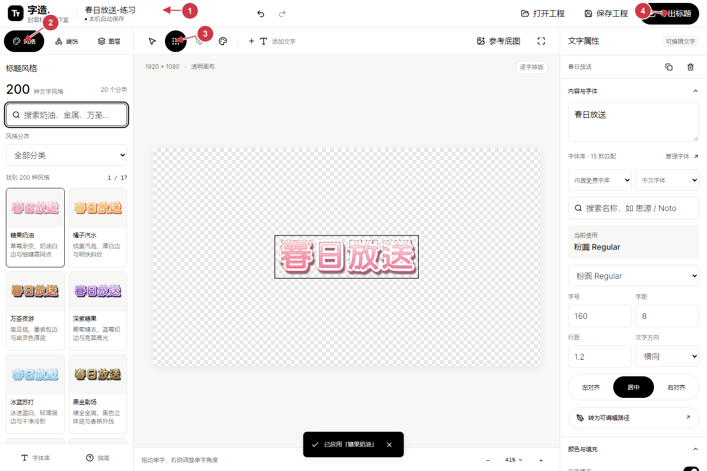
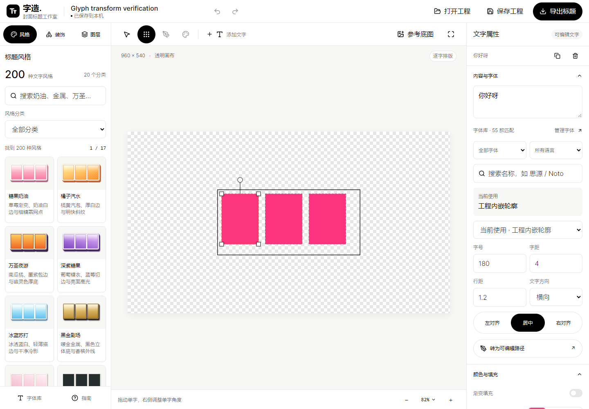
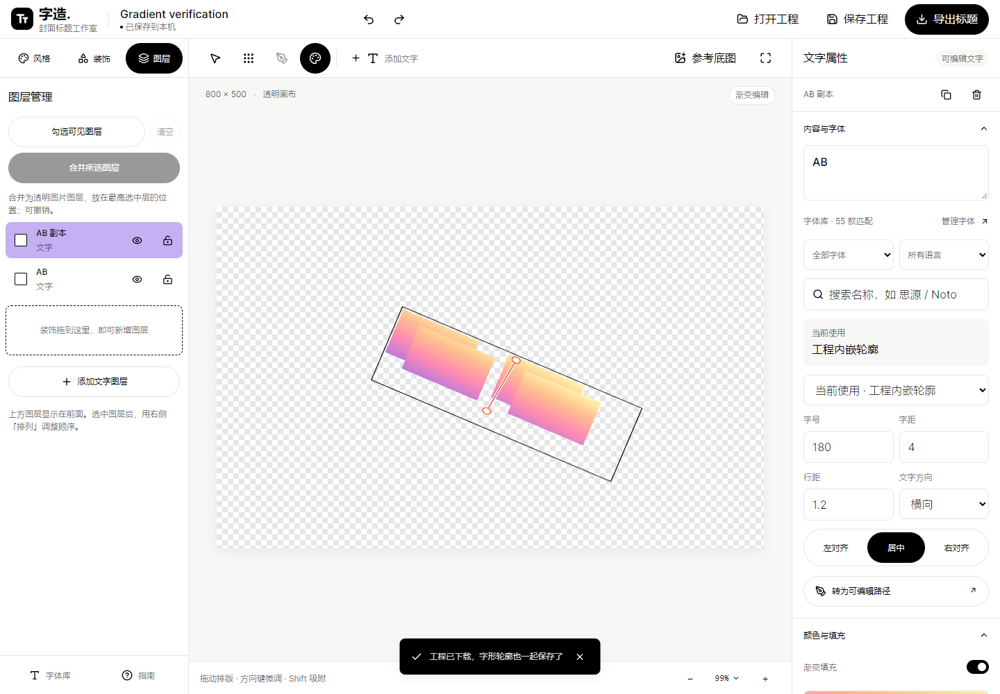
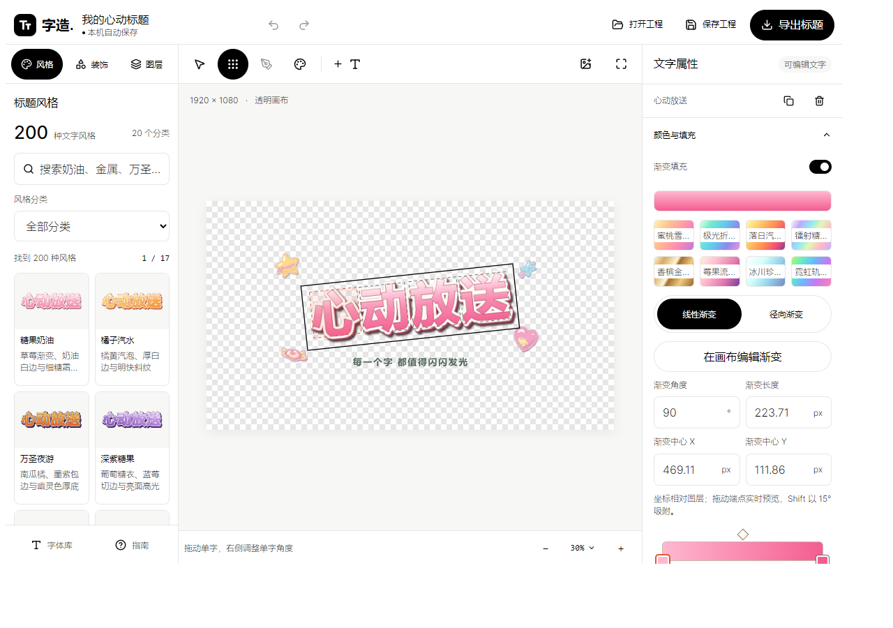

# 字造 · 封面标题工作室

**Zizao Title Studio** —— 在本地做封面标题的桌面工具：输入文字、挑字体和风格、逐字排版，导出透明 PNG / 分层 PSD / SVG。



离线可用：字体、算法、素材、预览和导出都在本机跑，不联网也能完成全部排版与导出。

`Windows 10/11 x64` · `Electron 45` · `React + TypeScript + Vite` · 内部版本 **1.5.0**

---

## 它解决什么问题

做封面标题时，常规流程是「在 PS 里一个字一个字调」：换字体、拉渐变、加描边、叠厚度、控制每个字的缩放和旋转、最后还要能分层回去改。

字造把这些收进一个编辑器：

- **200 款文字风格** + **400 个矢量装饰**，点一下就能换外观，参数随时改回来；
- **55 个内置开源字体家族**（15 个含中文），不用先装字体；
- **逐字排版**：每个字可以单独移动、缩放、旋转；
- **画布上直接拖渐变手柄**，像 Photoshop 的渐变工具；
- **导出真的分层 PSD**：可以按图层，也可以把每个字拆成独立图层和图层组。

---

## 功能

| 模块 | 说明 |
| --- | --- |
| 文字风格 | 200 款预设、20 个分类，可搜索；材质、渐变、双层描边、立体厚度、投影都能单独调 |
| 逐字排版 | 默认逐字模式，拖哪个字动哪个字；方向键微调，Shift 加速 |
| 单字变换框（1.5） | 双击某个字出现变换框：四角缩放（Shift 等比）、上方圆点旋转（Shift 15° 吸附），一次拖动一条撤销 |
| 画布渐变（1.4） | 线性为起点/终点手柄，径向为圆心 + 两个半径手柄；色标条支持增删拖、中点、HEX、反转；键盘可达 |
| 花体与哥特 | 各 5 款轮廓算法，保留中文内部空间，可转可编辑路径后逐节点改 |
| 图层 | 显隐、锁定、排序、复制、合并 |
| 导出 | 整张 PNG、所选图层 PNG、逐层 PNG ZIP、分层 PSD（按图层 / 逐元素）、SVG、`.zizao.json` 工程 |
| Photoshop 面板 | CEP 面板，可在 PS 里直接开编辑器，「送入 PS 新文档」建成分层文档 |

### 双击单字 → 缩放与旋转



拖角点单独放大缩小这一个字，拖上方圆点单独旋转；松手才写一次撤销。

### 在画布上编辑渐变



渐变几何存在图层局部的归一化坐标（0–1）里，不是屏幕像素：缩放、导出倍率、裁切都不会改变渐变相对文字的位置。预览、PNG、逐层 PNG、SVG 和两种 PSD 分层模式读的是同一份几何。

### 分层 PSD

导出对话框的 PSD 有「分层方式」两档：

- **按图层**：一个文字图层仍是一个栅格层，外观与画布完全一致（默认，行为与旧版相同）；
- **逐元素**：每个字符、每个装饰部件各成一层，按源图层建图层组（组名 = 图层名，子层名 = 字符本身）。显隐、锁定、组顺序与图层顺序一致，组透明度只烘一次。

逐元素会分别重算重叠的投影、厚度和材质效果，合成外观可能与按图层略有差异——这是把效果分配给单个元素必然的代价，导出前的提示里也写了这一句。逐元素的 512 层上限按叶子层计数（含隐藏元素），超过会直接报错并提示拆分工程，不会悄悄少导出几层。

### Photoshop 面板



双击 `字造-Photoshop插件-安装版-1.5.0.exe` 即可安装：把面板放进 `%APPDATA%\Adobe\CEP\extensions\com.zizao.title-studio`，并把 `CSXS.12` 的 `PlayerDebugMode` 设为 `1`（未签名 CEP 面板必需）。卸载时这两项按安装前的值原样还原。

---

## 下载使用

安装包都在 [Releases](https://github.com/davidd4242/zizao-title-studio/releases/latest) 页面，三个包按需要选：

| 包 | 适合 |
| --- | --- |
| `字造-1.5.0-完整安装版.exe` | 想装一次就有桌面快捷方式 |
| `字造-免安装.zip` | 想解压即用、不写系统 |
| `字造-Photoshop插件-安装版-1.5.0.exe` | 需要在 Photoshop 里开面板 |

安装包未签名，Windows 可能显示 SmartScreen 提示；确认文件名与来源后继续。

---

## 从源码运行

需要 Node.js 22+。

```bash
npm install
npm run build      # 类型检查 + 前端构建
npm start          # 启动本机服务，打开 http://127.0.0.1:4178
```

开发模式下前端和字体 API 分开跑：

```bash
npm run dev        # 开发页面
npm start          # 另开一个终端跑字体 API 和已构建页面
```

### 构建 Windows 程序

```bash
npm run pack:exe                              # 目录版 + 单文件版
npx electron-builder --config desktop/builder.cjs --win portable --x64
```

### 构建 Photoshop 面板

```bash
npm run pack:photoshop      # 生成插件 zip
```

面板包的安装器由 NSIS 编译（`desktop/plugin-installer.nsi` + `scripts/package-plugin-installer.mjs`）。

---

## 目录结构

```
src/               编辑器：画布、属性面板、导出、PSD 写入、渐变与字形变换
  engine.ts        轮廓、渐变、材质、效果的 SVG 渲染（画布与导出共用）
  psd.ts           PSD 写作与两种分层策略
  psd-elements.ts  逐元素分层：字符与装饰部件的分组
  gradient.ts      渐变模型与旧工程角度映射
  glyph-transform.ts 单字缩放/旋转的几何
server/            本机字体 API 与静态服务（仅监听回环地址）
photoshop/         CEP 面板、宿主桥、安装脚本、运行时打包
desktop/           electron-builder 配置与 NSIS 安装脚本
assets/fonts/      55 个开源字体家族（含每家族许可证与 manifest）
tests/             node:test 单测与真实浏览器/桌面验收
scripts/           打包、发布、各轮验收脚本
docs/screenshots/  README 用的截图
```

---

## 技术与取舍

- **Electron 45 + React + TypeScript + Vite**：桌面端需要本机字体、文件读写和 Photoshop 桥接。
- **画布与导出共用一套渲染**：`engine.ts` 生成 SVG，画布直接嵌、导出走 Sharp 栅格化，避免「屏幕上和导出的不一样」。
- **PSD 用 `ag-psd` 写**：图层记录按「底 → 顶」写入（Photoshop 面板反向显示），已在 PS 27.11 原生验证。
- **渐变用显式端点而不是角度**：旧工程只有角度时按原公式换算成端点，换算前后逐像素一致。
- **服务只监听 `127.0.0.1`**：校验 Host、Origin 与实例 token，非本机连接直接拒绝。

---

## 测试

```bash
npm test                    # 单测：字体、轮廓、渐变、PSD 分层、字形变换…
npm run test:desktop -- <字造.exe 路径>   # 对打包产物做隔离离线验收
```

当前：`npm test` **119 / 119 通过**。另有真实浏览器验收（Edge headless + Playwright）覆盖渐变手柄、单字变换框、面板 `file://` 加载等只有真浏览器能抓的行为，以及真实 Photoshop 27.11 打开逐元素 PSD 的核对记录。

---

## 字体与许可

内置 55 个字体家族是完整上游文件，附来源、校验值与逐家族许可证，见 [字体说明](assets/fonts/README.md) 与 [字体清单](assets/fonts/manifest.json)：50 个家族 OFL-1.1，5 个 Apache-2.0。字体在本地解析，不需要装进系统。

字体随各自许可证分发；商用前请按对应许可证确认署名要求。

---

# 详细使用说明

## Windows 程序

使用 `字造-免安装.zip`。右键选择「全部解压缩」，以后双击解压文件夹里的「字造.exe」。保留整个文件夹，包含 resources、DLL 和其他运行文件；需要桌面入口时创建快捷方式。完整解压一次后，正常启动直接读取本地文件，省去单文件便携包每次重新解压的等待。

适用 Windows 10/11 x64，已包含 Chromium、Node、编辑器和完整字体文件，无需另外安装 Node.js 或连接网络。内部版本为 1.5.0。可选单文件程序仍使用临时目录，每次启动会重新解压。

启动时先显示启动提示，再显示带有「正在加载中」提示的模糊工作台。字体和工程准备就绪后，提示与模糊一起消失。工作台出现「加载遇到问题」时保留原来的自动保存，并提供「重新加载」按钮；加载期间暂停编辑快捷键和自动保存。若桌面出现「启动遇到问题」或「字造启动失败」，记录原因与日志位置，关闭后重新启动。

自动保存、关联字体目录和导入字体放在 `%APPDATA%\ZizaoStudio`，与 EXE 的位置无关。1.0–1.3 使用同一份本机草稿；更新前可先保存工程备份。浏览器版、Windows 程序、Photoshop 面板的草稿分别保存，使用 `.zizao.json` 工程互相传递。

## 界面与搜索

工作台使用 Figma 设计系统的黑白工具栏、细分隔线和圆角按钮。左侧整理风格、装饰和图层，中间排版，右侧编辑属性。画布中的标题配色独立于界面主题。

字体搜索支持全角输入和多个空格分隔的关键词，全部关键词匹配后才显示结果。当前使用的字体单独显示；零匹配时保留当前字体，停用候选下拉框，并提供清空筛选入口。搜索框只显示一层焦点边框，字体、风格与装饰共用清空按钮行为。

装饰使用独立色面、彩色轮廓、可选高光和统一的底部厚度。原有 400 个素材 ID 保留，装饰仍支持路径编辑。打开旧工程时保留工程中已经保存的轮廓和外观。

## 做出第一张标题

1. 选择文字图层，在右侧「内容与字体」输入标题，回车换行；上方「添加文字」建立新图层。
2. 搜索字体，或按「内置免费字体 / 我的字体库」与语言筛选。字号、字距、行距、对齐和横竖排都可调整。
3. 在左侧「风格」按分类或关键词挑选预设。每页显示部分样式，翻页查看剩余内容。
4. 默认进入「逐字排版」：拖一个字，只移动这个字。方向键微调当前字，Shift 加速。要移动、缩放、旋转整组文字，先在图层列表选中整层，再切换顶部「选择与移动」。
5. 右侧可调整多段渐变、色相、材质、双层描边、立体厚度和投影。内外描边都有实时滑条，也可输入精确数值；一次拖动只记录一次撤销。
6. 从「装饰」拖到画布的指定位置，或拖到「新增图层」区域。拖动时有跟随预览和落点高亮；悬停左侧图层入口可展开图层列表。点击装饰也可添加，Esc 取消拖动。
7. 点击「导出标题」，选择输出格式、裁边与精度。参考底图和透明棋盘格只用于预览，不进入导出文件。

## 颜色、材质与字形

「颜色与填充」支持 2–6 个色标，可调整位置、增减颜色、反转渐变、改变色相，并在线性与径向渐变之间切换。

选中图层并开启渐变后，画布上会出现渐变手柄：线性是起点、终点两个手柄加一条连线；径向是圆心手柄加水平、垂直两个半径手柄。拖动手柄实时改变预览，按住 Shift 按 15° 吸附；一次拖动只记一次撤销。右侧的「角度」「长度」「中心」「半径」数值与手柄双向同步。

色标条可以直接双击加色标、拖动色标改位置、拖动两个色标之间的菱形改中点、输入 HEX、一键反转。色标条是键盘可达的：Tab 进入后用方向键每次移动 1%，按住 Shift 变成 5%，Home/End 跳到两端，Delete 删除当前色标。

和 Photoshop 的差别有两处，写在这里以免对照时误判。第一，Photoshop 的渐变填充以选区或对象的包围盒为参考框（objectBoundingBox），本工具用显式的图层局部端点，所以不依赖角度起算方向。第二，Photoshop 色标之间的中点是伽马式非线性过渡，本工具用插入平均色中间色标的方式近似，观感接近但不是逐像素相同。本机 Photoshop 27.11 的脚本渐变接口会挂起（证据见 [PROGRESS.md](PROGRESS.md) 的决策记录），因此角度方向与中点曲线没有做 Photoshop 侧的数值实测，这里只写可以核对的部分。

「文字材质」提供镜面金属、磨砂玻璃、流心软糖、棉质纸张、霓虹灯管。材质与现有渐变叠加；选择「原色」清除材质，强度控制效果程度。

「花体与哥特字形」各有 5 款轮廓算法。1.3 调整了字身的粗细对比、局部笔端和首尾延伸，保留中文内部空间。新字体轮廓使用 nonzero 填充，修正同向重叠笔画被挖空的问题；旧工程未记录填充规则时保留原来的外观。

预览区显示原字形对照，提供「纯轮廓」和「当前外观」两种查看方式。切换预览不会改变作品。应用后文字成为可编辑路径；强度与切换样式始终基于保存的原字形重算，不反复累积变形。「恢复原始字形」恢复转换前的轮廓与文字状态。复杂中文可降低强度；如已手工编辑节点，先复制图层，再切换算法以保留手工版本。

## 字体库

内置 55 个字体家族：15 个包含中文，40 个主要用于英文。中文家族中，11 个通过简体样本、9 个通过繁体样本检测，部分同时覆盖两者；全部家族通过常用英文 ASCII 字符检测。具体汉字覆盖依字体而异，编辑器会提示缺字。

自己的字体库仍可使用：

- Windows 已安装字体、当前用户字体及注册的其他位置自动扫描。
- 在「字体库」输入文件夹路径进行关联，关联本身不复制原文件。
- 可导入 TTF、OTF、TTC、WOFF、WOFF2，单文件上限 80MB。
- 文件夹新增字体后点击「刷新列表」。

工程保存字形轮廓；重开、排版、导出既有轮廓不依赖原字体。继续更改文字内容时，对应字体应仍在可用字体库里。

## 图层、路径与导出

图层支持显隐、锁定、复制和顺序调整。勾选至少两个可见且解锁的图层后可合并。合并会将选中的内容栅格化为一个透明图片图层，并放在选中图层的最高位置；撤销可恢复。若选中的图层不相邻，与夹在中间的其他图层之间的遮挡关系可能改变。半透明内容合并后再与其他图层叠加，会有 8 位像素取整造成的细微色差；合并结果保留独立透明背景，可继续移动。

「转为可编辑路径」可进入节点模式。点选锚点拖动，曲线节点显示控制柄；右侧「精确选择节点」用于重叠节点，也可细分曲线或删除节点。

导出方式：

- **整张 PNG**：可见图层合成为一张透明图片。
- **所选图层 PNG**：单独输出所选图层。
- **逐层 PNG ZIP**：每个可见图层一张 PNG，使用相同画幅与裁边区域，保留相对位置；名称包含顺序编号。
- **分层 PSD**：输出独立图层，保留名称、顺序、位置、显隐与锁定。文字、材质和装饰栅格化为各自的像素层；不变成 Photoshop 可输入的文字或可编辑图层样式。
- **SVG**：保存文字轮廓与矢量装饰，内嵌导入图片。
- **字造工程**：保存可继续编辑的文字、节点、字形源轮廓、渐变、材质与图片。

裁边模式按作品范围输出；完整画布模式保持画布尺寸。可选 1×、2×、3×。PSD 与逐层 PNG 有内存预算检查，尺寸过大时降低输出精度或缩小画幅。

## 保存与快捷键

自动保存用于恢复最近的草稿。正式留档使用「保存工程」下载 `.zizao.json`；「打开工程」可继续编辑。

| 操作 | 快捷键 |
| --- | --- |
| 撤销 / 重做 | Ctrl+Z / Ctrl+Shift+Z 或 Ctrl+Y |
| 复制图层 | Ctrl+D |
| 保存工程 | Ctrl+S |
| 删除选中图层 | Delete |
| 微调所选字或图层 | 方向键，Shift 为 10px |
| 拖动吸附 | Shift：位置 10px、旋转 15° |
| 取消装饰拖动 / 退出节点 / 关闭弹窗 | Esc |

窄屏使用底部「风格与素材」「编辑属性」切换。素材面板内可切换风格、装饰和图层。

## 浏览器版

执行 `npm start` 后打开 `http://127.0.0.1:4178`。迁移源码到其他电脑需 Node.js 22+，执行 `npm install`、`npm run build` 后启动。浏览器版字体关联与导入文件保存在项目的 `data/` 目录，服务仅监听本机回环地址。

其他脚本：

- `npm run test:upgrade`：真实鼠标交互与新版功能验收。
- `npm run verify:fonts`：核对完整字体文件、来源、许可证和哈希。
- `npm run pack:exe`：生成离线 EXE。
- `npm run test:desktop -- <EXE路径>`：对单文件程序执行隔离离线验收。
- `npm run pack:photoshop`：打包 Photoshop 面板。
